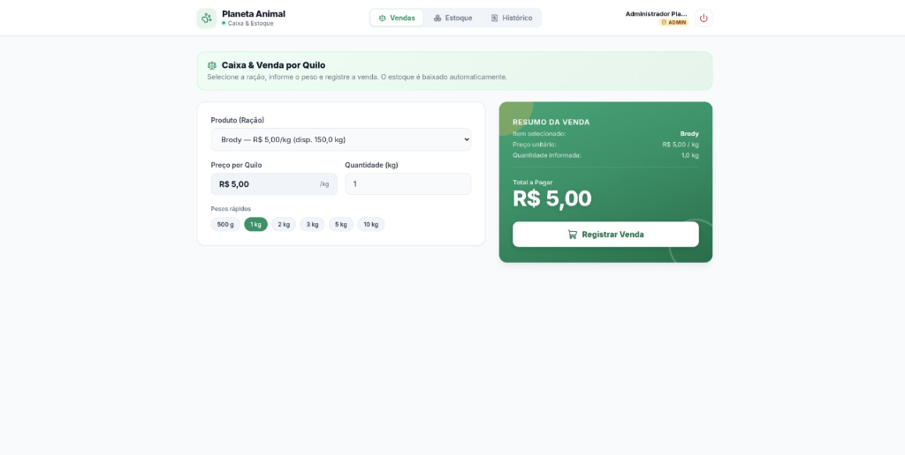
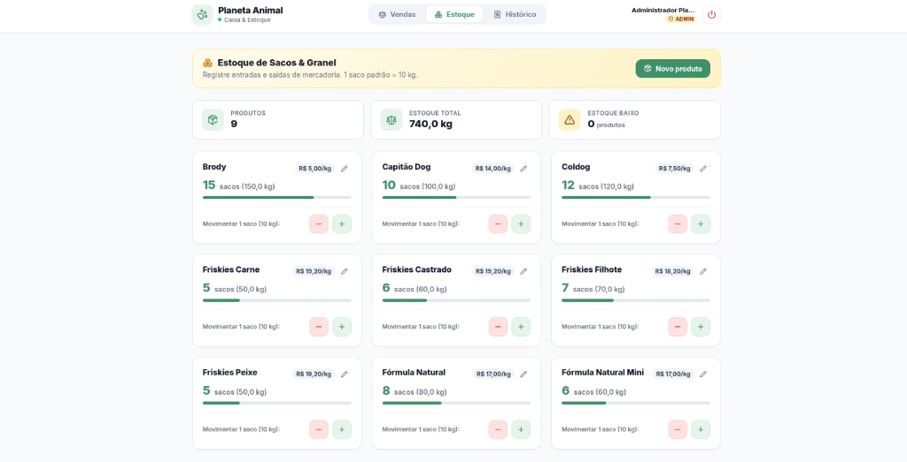
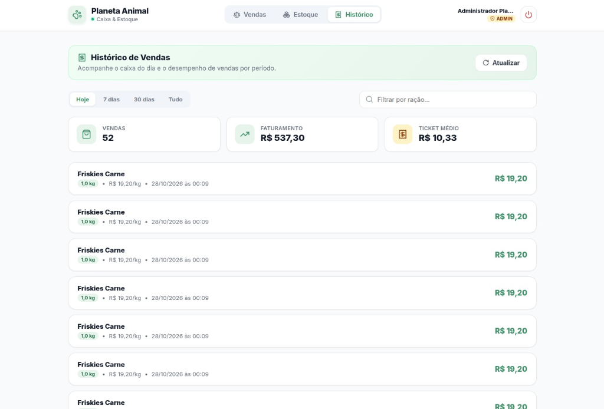
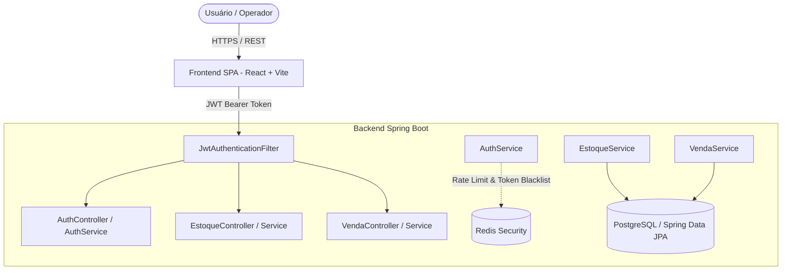

# Planeta Animal — Case Study & Showcase

  <strong>Sistema inteligente de ponto de venda (PDV), pesagem a granel e controle integrado de estoque para Pet Shops e Agropecuárias.</strong>

  
  
  
  
  
  
  
  
  

---

## Sobre o Projeto

O **Planeta Animal** é uma aplicação completa desenvolvida para resolver uma dor crítica no varejo pet e agropecuário: **a venda de ração a granel e a correspondência exata com o estoque em fardos/sacos fechados**.

Em rotinas de alta rotatividade, a pesagem de pequenas porções (500g, 1kg, 2.5kg) costuma gerar gargalos no caixa e divergências no controle físico do estoque. Esta solução automatiza o cálculo fracionado, deduz atomicamente a quantidade comercializada e fornece aos operadores e administradores visão em tempo real do faturamento e nível de reposição.

---

## Demonstração das Telas e Funcionalidades

### 1. Caixa e Venda por Quilo (Ponto de Venda)
Foco em agilidade, ergonomia e precisão operacional para o operador de caixa:

* **Seleção Dinâmica com Saldo Imediato:** O operador escolhe a ração e visualiza instantaneamente o estoque disponível em quilos.
* **Atalhos de Pesagem Rápida:** Botões de 1 clique para frações comuns (`500g`, `1kg`, `2kg`, `3kg`, `5kg`, `10kg`), além de input livre para qualquer peso de balança.
* **Resumo da Venda em Tempo Real:** Feedback visual com cálculo instantâneo do valor total a pagar.
* **Baixa Atômica:** Cada venda concluída atualiza imediatamente o inventário, prevenindo inconsistências ou venda de estoque negativo.

---

### 2. Gestão de Estoque de Sacos e Granel
Controle visual inteligente do inventário fracionado e fechado:

* **Cards de Indicadores no Topo:** Total de produtos ativos, volume total em estoque (kg) e alerta visual de itens com estoque baixo.
* **Equivalência Saco / Granel:** Padronização clara (ex.: 1 saco = 10 kg), exibindo tanto a contagem em sacos quanto o total disponível em quilogramas.
* **Barra de Nível de Estoque:** Indicador visual de capacidade para reposição ágil.
* **Ajuste Rápido (+ / -):** Ações diretas de entrada e saída de sacos sem necessidade de fluxos burocráticos.
* **Cadastro e Edição:** Modal para inserção de novos itens ou atualização de preços por quilo.

---

### 3. Histórico de Vendas e Indicadores Financeiros
Acompanhamento em tempo real para tomada de decisão e fechamento de caixa:

* **Métricas do Dia:** Cards de resumo com total de vendas concluídas, faturamento bruto e ticket médio calculado dinamicamente.
* **Filtros Temporais:** Alternância rápida entre `Hoje`, `7 dias`, `30 dias` e `Tudo`.
* **Busca e Filtragem:** Busca em tempo real pelo nome da ração.
* **Extrato Detalhado:** Listagem cronológica com data/hora exata, quantidade em quilos, valor unitário e valor total recebido.

---

## Arquitetura e Engenharia do Sistema

---

## Destaques de Segurança e Boas Práticas

1. **Autenticação Stateless com JWT e Refresh Token:**
   - Tokens de curta duração (Access Token) combinados com Refresh Tokens seguros e rotativos, garantindo sessões seguras sem acoplamento de estado em memória local de aplicação.
2. **Proteção Anti-Brute Force com Redis:**
   - Contador de tentativas de login por IP e usuário com banimento temporário em caso de sucessivas falhas.
3. **Mitigação de Timing Attacks:**
   - O `AuthService` realiza verificação com hash fictício mesmo para usuários inexistentes, eliminando variações no tempo de resposta e prevenindo enumeração de usuários.
4. **Criptografia Forte com BCrypt:**
   - Fator de custo 12 para todas as senhas armazenadas.
5. **Controle de Acesso Baseado em Perfis (RBAC):**
   - Papéis distintos para `ROLE_ADMIN` (gestão, edição e relatórios completos) e `ROLE_OPERADOR` (fluxo de venda e caixa).
6. **Design Resiliente e Modular:**
   - Camadas estritamente desacopladas: DTOs, Mappers (MapStruct/Lombok), Services com regras de negócio puras e Repositories Spring Data JPA.

---

## Qualidade de Código e CI/CD

* **Testes Automatizados:** Testes unitários e de integração cobrindo controladores de autenticação, filtros de segurança e regras de negócio de venda e estoque.
* **Cobertura com JaCoCo:** Relatórios de cobertura de código integrados na esteira de compilação Maven.
* **Pipeline GitHub Actions:** Validação contínua e build automático a cada push ou pull request, garantindo código sempre pronto para deploy.

---

## Tecnologias Utilizadas

| Camada | Tecnologias |
| :--- | :--- |
| **Backend** | Java 21, Spring Boot 3, Spring Security, Spring Data JPA, Hibernate |
| **Banco de Dados** | PostgreSQL (Persistência relacional robusta, integridade referencial e transações ACID) |
| **Cache e Sessão** | Redis (bloqueio de força bruta, cache de autenticação) |
| **Frontend** | React 18, Vite, Lucide Icons, Vanilla CSS modular e responsivo |
| **Testes e Métricas** | JUnit 5, Mockito, JaCoCo |
| **DevOps** | GitHub Actions, Maven Wrapper, Node.js |

---

  Desenvolvido com foco em usabilidade, segurança e escalabilidade operacional.

